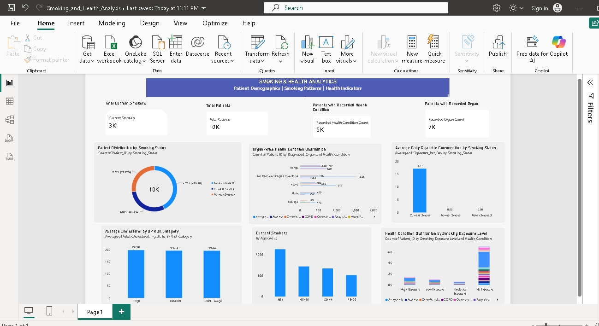

# Smoking and Health Analysis Dashboard

## Healthcare Analytics | Microsoft Power BI

An interactive Power BI dashboard developed as part of the Sapphire IQ internship project. This project analyzes patient demographics, smoking patterns, health conditions, and key health indicators using a dataset of 10,000 patient records.

## Project Overview

The objective of this project is to explore patient health data and present meaningful insights through interactive visualizations and KPI indicators.

The dashboard helps analyze:
- Patient smoking habits and smoking status.
- Health condition distribution across diagnosed organs.
- Average daily cigarette consumption.
- Cholesterol levels across blood pressure risk categories.
- Smoking patterns across different age groups.
- Health conditions across estimated smoking exposure levels.

## Tools and Technologies

- Microsoft Power BI
- Power Query
- DAX (Data Analysis Expressions)
- Data Visualization

## Dataset Overview

- Total patient records: 10,000
- Patient demographics: Age, Gender, Region
- Smoking information: Smoking Status, Cigarettes Per Day, Years Smoking
- Health indicators: BMI, Blood Pressure, Cholesterol, Resting Heart Rate
- Health information: Diagnosed Organ, Health Condition

## Project Objectives

### 1. Overall Patient Health KPIs
- Total Patients
- Current Smokers
- Patients with Recorded Organ
- Patients with Recorded Health Condition

### 2. DAX Calculated Columns
- Age Group
- BP Risk Category

### 3. Smoking Patterns and Health Indicators
- Average Cigarettes Consumed per Day by Smoking Status
- Organ-wise Health Condition Distribution
- Smoking Status Distribution
- Average Cholesterol by BP Risk Category

### 4. Patient Demographics and Health Patterns
- Current Smokers across Age Groups
- Health Condition Distribution by Smoking Exposure Level

## Dashboard Preview

## Key Findings

- The dataset contains 10,000 patient records.
- Approximately 3,000 patients are current smokers.
- The dashboard identifies differences in health condition distribution across diagnosed organ categories.
- Average daily cigarette consumption is compared across smoking statuses.
- Cholesterol levels are compared across blood pressure risk categories.
- Patient smoking patterns are explored across age groups and estimated smoking exposure levels.

## Disclaimer

This project is intended for educational and exploratory data analysis only. The findings do not establish medical diagnoses or prove that smoking causes specific health conditions.

## Project Information

**Project:** Smoking and Health Analysis Dashboard  
**Domain:** Healthcare Analytics  
**Organization:** Sapphire IQ  
**Tool:** Microsoft Power BI  
**Author:** Saif Chogle

---

*Developed as part of the Sapphire IQ internship project.*
